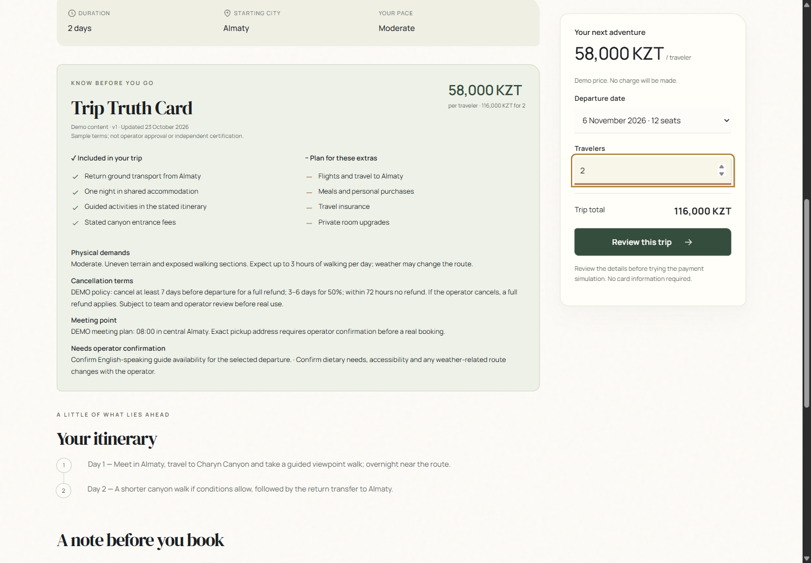
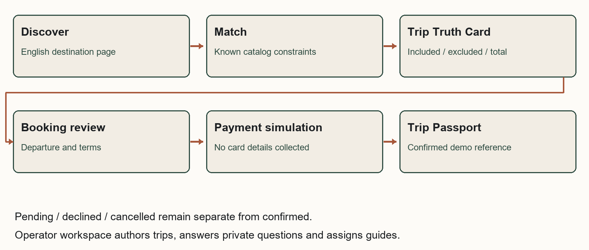

<!-- Report page 1; main content -->

# Samal Journeys

Technology Product Proposal for Saryarqa Routes

ZERTTEX Hackathon 2026  |  TeamName placeholder  |  23 October 2026

## Problem and Market

AI-assisted working draft for substantive team review. Samal Journeys is a proposed browser application for Saryarqa Routes that connects tour matching, transparent trip information, booking and operator follow-up. The recommended pilot is a narrow India-resident segment; commercial demand, user benefit and production readiness remain unproven.

### Company and problem

The fictional Saryarqa Routes was founded in Astana in 2020 and has 9 full-time employees and about 25 freelance guides. It sells guided trips of 2-7 days to Charyn Canyon, Kolsai Lakes, Turkestan and Burabay. In 2025 it served 3,400 travelers, earned 150,000,000 KZT and stated an average price of 44,000 KZT; about 96% of travelers came from Kazakhstan. Sales use Instagram messages, WhatsApp and calls; payment is by Kaspi transfer or cash. Its website is one page in Russian. The goal is 30% foreign travelers within 24 months; the first-year development and launch budget is up to 20,000,000 KZT. [C, pp.1-2]

Foreign guests in the case report unclear booking, uncertain trust, foreign-card failure and unclear inclusions. These are supplied case complaints, not interviews conducted for this project. Multiplying the supplied traveler count by the average gives 149,600,000 KZT, 400,000 below reported revenue; both case values are preserved. [C]

### One proposed segment and alternatives

| Country | Accommodation guests | Pilot judgment |
| --- | --- | --- |
| China | 127,059 | Largest flow here; language and channel fit require separate research. |
| India | 91,148 | Proposed pilot; official access evidence supports a focused test. |
| Germany | 24,672 | Credible alternative; smaller flow, customer value unmeasured. |

Counts cover January-September 2024 guests in Kazakhstan hotels and other accommodation, from a government summary citing BNS. They are not leisure-only demand, unique customers or an addressable sales market; nationality/residence and repeat-stay detail are incomplete. [S01]

The proposed segment is India-resident adults comfortable booking in English, traveling as couples or small friend groups and considering a 2-3 day nature trip from Almaty. This preference is a hypothesis. The Embassy notice describes up to 14 visa-free days for Indian citizens, subject to the stated 42-day/180-day limit. Air India documents Delhi/Mumbai-Almaty services; its 2025 codeshare announcement was subject to approvals. Recheck actual entry rules and schedules. Operator delivery from Almaty also needs confirmation. [S02-S03]

For this proposed English-booking segment, the Russian-only page and message-based sales may obstruct discovery and self-service; the strength of that barrier needs interviews. Test operator-approved English destination pages and a capped search campaign aimed at people already considering Kazakhstan. Measure qualified visits through completed trips, not clicks alone. Clear meeting details, exclusions and cancellation terms address the case complaints; transparent payment recovery addresses uncertainty after a decline.

---

<!-- Report page 2; main content -->

## Existing Solutions and Product

Samal Journeys should be assessed against configuring existing tools. The following vendor evidence identifies useful capabilities and unresolved fit, not proven competitor weaknesses. [S04-S05]

| Dimension | Viator marketplace | Bokun operator software |
| --- | --- | --- |
| Discovery and journey | Marketplace distribution; customer booking and payment. | Direct booking widgets plus OTA and marketplace channels. |
| Transparency and control | Operator controls listing content, retail price and availability; submission review. | Operator manages product content, availability, resources and payment links. |
| Payment and operations | Vendor handles payments/refunds; pays after experience. Kazakhstan payout eligibility unverified. | Booking and channel management; Kazakhstan gateway suitability and Halyk connection unverified. |
| Cost and effort | USD29 per submitted product plus completed-booking commission; exact rate needs contract. Listings need preparation. | START USD49/month plus 1.5% applicable-booking fee, up to five users; setup and payment fees may be additional. |

No USD-to-KZT conversion is assumed. During weeks 1-2, test whether a configured tool can meet the operator workflow and local payment needs at lower total cost. If it can, prefer configuration. Custom development creates maintenance and security obligations; it is justified only if the shared-content journey adds demonstrated value.

### One mechanism across five capabilities

The Trip Truth Card is one structured, operator-controlled record of itinerary, departure/meeting details, price, inclusions, exclusions, physical demands, cancellation terms and content status. Matching, checkout and the Trip Passport reuse it. The proposed benefit is fewer contradictory promises; no conversion increase or unprecedented invention is claimed.

---

<!-- Report page 3; main content -->

## Journey and Technical Scope

The five capabilities are catalog matching, Trip Truth Card, guided booking, Trip Passport and operator workspace. Matching uses dates, party size, budget, city, interests and difficulty to return compatible departures. Checkout preserves traveler drafts when navigating or reloading, and requests fresh consent when accepted terms change. Only simulated success confirms a Passport; pending, declined and cancelled remain distinct. Operators can author tours, edit content and future capacity, assign guides and answer private traveler questions. The Passport preserves accepted price and policy snapshots after catalog edits. Answers come from the operator; the product does not invent itinerary details or credentials.

### Demonstration and production boundary

The local prototype uses Node 24.16, HTML/CSS/JavaScript and persistent JSON, with no npm dependencies or API key. It has no live AI, real payments or service worker. Its dedicated presentation mode seeds future dates and can reset its own backed-up store. The warm editorial interface uses local fonts, licensed destination photographs without effects and responsive navigation. Tour prices, policies, capacity and traveler records are synthetic; guide assignment records a state, not a verified credential. Demo operator access is unsuitable for public exposure.

The planned production system retains one application and catalog/booking model, with transactional storage, durable reservation holds, authenticated operator roles, audit events, backups and a hosted checkout. Personal data should be minimized; no card number or passport is needed in this demonstration. Production retention, consent and customer terms require operator and legal review. No compliance certification is claimed.

### Payment evidence and conditions

Halyk ePay is a candidate. Official information describes account/application/terminal onboarding and an other-bank-card tariff of 3%. Hosted-page examples support KZT requests and English; full/partial refund and test/status endpoints are documented. These facts do not prove India-issued-card acceptance or contractual settlement currency/timing. Obtain written merchant approval, issuer support, fee/refund terms and test results before launch. The demo is not a Halyk sandbox. [S06-S10]

For production, keep merchant secrets server-side, check invoice/amount/currency/terminal, validate notifications and query authenticated provider status. Confirm only a verified final charge; a browser return or successful status request alone is insufficient. Unique payment/event keys and atomic inventory updates must prevent duplicate confirmation. [S08-S10]

---

<!-- Report page 4; main content -->

## MVP and Implementation

The proposed pilot takes approximately 12 weeks after operator and team agreement. The model allocates 960 paid hours: product/research 180, application/payment engineering 540, QA 120, and content/training 120. Engineering averages 45 hours/week, shared by an engineering lead and integration support. A product/UX lead, QA/security support and operator content/launch owner cover the other roles. These rates and capacity are planning assumptions, not supplier quotes.

| Weeks | Deliverables and owner | Dependency and acceptance gate |
| --- | --- | --- |
| 1-2 | Product/UX + operator: verify segment, audit catalog, compare build versus configure; start payment onboarding. | Team-owned strategy; approved sample Truth Card; merchant requirements received. |
| 3-4 | Designer + engineer: matching, tour page, responsive layout, schema and inventory model. | Catalog content ready; no-match and price consistency pass; early comprehension tests. |
| 5-6 | Engineer: booking, atomic holds, hosted checkout adapter, passport and operator controls. | Approved provider test access; duplicate/failed/pending events cannot overbook or falsely confirm. |
| 7-8 | QA/security + operator: refund/reconciliation tests, role access, privacy controls and content audit. | Merchant terms agreed; no unresolved critical security/payment defect; guides/transport verified. |
| 9-10 | UX + operator: recruit ten target adults, run consented tasks, train staff and revise. | Consent and synthetic test data; actual observations recorded, failures prioritized. |
| 11-12 | Engineer + operator: retest fixes, rehearse operations, approve capped live pilot. | Critical gates passed, support/refund owner ready, approved capacity and rollback plan. |

### Real-user testing is planned

No interviews or surveys have been conducted. Recruit ten India-resident adults comfortable booking in English who are considering Kazakhstan, with varied travel experience and devices. Explain voluntary participation, no purchase and separate recording consent. Use anonymous codes and synthetic traveler details; collect no payment-card or passport data. Follow the full protocol in docs/validation_protocol.md.

Ask participants to find a suitable departure, state two exclusions and the full KZT party charge, explain cancellation, complete a demo booking, recover from a decline and distinguish pending from confirmed. Proposed thresholds: at least 8/10 unassisted core completions, 9/10 correct price/exclusions, and 10/10 correct safety-critical payment-state interpretation. These are decision gates, not results. Report true numerators and denominators; a small formative sample cannot establish conversion uplift.

Agent-driven Chrome checks exercised 1440, 768 and 360px layouts, mood filters, new-tour authoring/matching, private question and answer persistence, guide assignment and booking recovery. A three-person Charyn booking retained its accepted 174,000 KZT total after the catalog price and cancellation policy changed. Checkout drafts survived navigation/reload and required renewed consent. Declined, pending and confirmed states were visibly distinct. Keyboard focus was visible and the final warning/error log was empty. All 42 automated tests passed. Review and regression checks fixed stale checkout responses, multiline input, departure limits and the live party total on the Truth Card. These are software checks, not user research; see docs/full-demo-verification.md and docs/samal-verification.md.

---

<!-- Report page 5; main content -->

## Costs and Payback

All financial figures below come from finance/summary.json and its reproducible model, in KZT. The illustrative forecast begins January 2027; development occupies months 1-3 and the pilot begins month 4. Costs, traffic, conversion, margins and seasonality are unvalidated assumptions. The case average of 44,000 KZT drives the model; synthetic prototype tour prices do not. No legacy revenue, online migration, internal commission or staff-time saving is counted as new income.

| Initial work | Hours | KZT/hour | KZT |
| --- | --- | --- | --- |
| Research and journey design | 80 | 7,000 | 560,000 |
| Product and interface design | 100 | 8,000 | 800,000 |
| Application engineering | 480 | 9,000 | 4,320,000 |
| QA, accessibility and security review | 120 | 7,000 | 840,000 |
| Approved content and translation | 80 | 6,000 | 480,000 |
| Operator training and launch | 40 | 6,000 | 240,000 |
| Production payment integration allowance | 60 | 9,000 | 540,000 |
| Initial work total | 960 |  | 7,780,000 |

Running cost is 260,000/active month: Hosting and monitoring allowance 35,000; AI usage allowance 15,000; Maintenance 90,000; Customer support 90,000; Content maintenance 30,000. Marketing is one separate 200,000/active-month line. Year-one running and marketing are 2,340,000 and 1,800,000. Contingency is 1,518,000: 15% of the sum of initial work and year-one running, conservatively treated as cash spent in month 3. No student or AI labor is assumed free.

| 24 month model metric | Base | 30% fewer travelers |
| --- | --- | --- |
| Incremental completed travelers | 1,680 | 1,176 |
| Incremental tour revenue | 73,920,000 | 51,744,000 |
| Incremental contribution | 19,219,200 | 13,453,440 |
| Cumulative project cash flow | 261,200 | -5,504,560 |
| Peak funding required | 11,378,800 | 12,147,792 |
| First nonnegative cumulative month | Month 23 | Not reached in 24 months |
| Year 1 gross cash uses | 19,298,800 | 17,540,560 |

At 44,000 realized revenue per traveler, assumed delivery cost is 70%, payment cost 3% and other variable service 440. Contribution is therefore 11,440 (26%) per completed traveler. The payment rate is informed by the published other-bank tariff but remains subject to merchant terms. [S06-S07] Cash flow subtracts fixed running, marketing, development and contingency from contribution; there are no evidenced cash savings.

The first-year fixed project envelope is 13,438,000; gross uses including incremental tour delivery and variable fees are 19,298,800, below the case's 20,000,000 ceiling under a deliberately stricter planning rule. Downside keeps fixed costs unchanged and reduces only completed travelers and genuinely variable costs by 30%. Revenue is not profit; tax, settlement timing and supplier terms require validation.

---

<!-- Report page 6; main content -->

## Impact Risks and Conclusion

### Acquisition and capacity determine the result

The proposed funnel is qualified visit -> inquiry (10%) -> paid party (15%) -> 2 travelers -> completed trip (80%). It produces 180 new travelers in year 1 and 1,500 in year 2. Qualified sessions rise from 7,500 to 62,500, or 8.33 times. The assumed 80% earned/direct/referral/partner traffic is not secured. Marketing cost per incremental completed traveler drops from 10,000 to 1,600; this ambitious improvement is the principal commercial risk.

Year-two foreign share uses the annual months 13-24 denominator: 1,486 foreign / (1,486 foreign + 3,414 domestic) = 30.33%. Downside is 24.29%, missing the goal. Approximate baselines are 136 foreign and 3,264 domestic; incremental mix is assumed 90% foreign. Capacity assumes groups of 12, 4 guide-days including buffer and about 25 freelancers available 12 days/month. Peak base utilization is 84%; language, location, vehicles and guide availability are unverified.

| Risk and owner | Mitigation | Warning or stop trigger |
| --- | --- | --- |
| Misinformation / product owner | Approved card data; deterministic dates, price and seats; human follow-up. | Any unsupported promise or price contradiction. |
| Payments / finance + engineer | Merchant approval; issuer tests; verified events, refunds and reconciliation. | Unknown settlement terms, false confirmation or duplicate charge. |
| Privacy and security / engineer | Minimize data; secure roles, logs and retention; external review. | Sensitive data leak or unresolved critical access flaw. |
| Acquisition / growth owner | Capped cohorts; measure incremental completion and contribution. | Acquisition cost exceeds contribution for two cohorts. |
| Delivery and capacity / operator | Reserve guides, transport and suppliers; cap departures. | Unstaffed departure or planned guide load above 85%. |

Measure company impact through completed foreign bookings, contribution and support time; traveler impact through correct comprehension and booking completion. Better information may improve these customers' experience of booking Kazakhstan travel. A single operator product cannot be claimed to transform the national tourism image. All these outcomes are planned until measured.

### Recommendation and next decisions

Proceed only as a small, measured pilot after substantive team and operator review. The base model reaches first payback in month 23 and ends at only 261,200 cumulative cash; the downside ends at -5,504,560 and does not pay back within 24 months. Recheck any later seasonal reversal and require adequate working capital. Do not scale on optimistic traffic assumptions alone.

Before submission, the team must verify sources itself, own and revise the strategy, confirm eligibility and team details, obtain the missing Stage 1 Rules and AI-use framework, and complete the declaration. TeamName remains a placeholder. This package is not automatically submitted or publicly deployed. The deadline in the case is 25 October 2026 at 23:59 Astana time. [C]

---

<!-- Report page 7; separate section -->

## References

All external pages below were opened on 23 October 2026, before the case deadline. No later publication is used as historical evidence. Undated live documentation is identified as such; the team must re-open and verify it before submission. English translations of source titles are marked in the source register.

[C] ZERTTEX Hackathon 2026. Stage 1 Case 1 Technology Product. Case release 23 October 2026, 10:00 Astana time. Three-page supplied PDF: company facts pp.1-2; tasks and optional enhancements p.2; scoring and submission checklist p.3. The source file is not republished in the repository.

[S01] Kazakhstan Tourism Industry Committee (citing Bureau of National Statistics). Top 10 countries: where did most tourists come from? [English translation of Russian title]. Publication: Not stated on opened page. Data: 2024-01 to 2024-09. https://www.gov.kz/memleket/entities/tourism/press/news/details/939940?lang=ru

[S02] Embassy of India, Astana. Kazakhstan Introduced Visa Free Travel for Citizens of India for up to 14 days. Publication: Original publication not stated on opened page; page update shown 2026-10-22. Data: Decree 464 dated 2022-07-07; information displayed on access date. https://www.indembastana.gov.in/page/kazakhstan-introduced-visa-free-travel-for-citizens-of-india-for-up-to-14-days/

[S03] Air India. Air India and Air Astana enter codeshare partnership. Publication: 2025-09-10. Data: 2025 announcement. https://www.airindia.com/content/air-india/in/en/newsroom/press-release/Air-India-and-Air-Astana-enter-codeshare-partnership.html

[S04] Viator Operator Resource Center. About Us: How Viator Works. Publication: 2025-06-03. Data: Published operator guidance as accessed. https://operatorresources.viator.com/about-us/

[S05] Bokun. Pricing. Publication: Not stated on opened page. Data: Live pricing observed 2026-10-23. https://www.bokun.io/pricing

[S06] Halyk Bank. Internet acquiring ePay [English translation]. Publication: Not stated on opened page. Data: Live merchant information observed 2026-10-23. https://halykbank.kz/business/payment/epay

[S07] Halyk ePay. Internet acquiring ePay from Halyk Bank [English translation]. Publication: Not stated on opened page. Data: Live service information observed 2026-10-23. https://epayment.kz/

[S08] Halyk ePay. Payment page [English translation]. Publication: Not stated on opened page. Data: Live API documentation observed 2026-10-23. https://epayment.kz/docs/platezhnaya-stranica

[S09] Halyk ePay. Refund/partial refund [English translation]. Publication: Not stated on opened page. Data: Live API documentation observed 2026-10-23. https://epayment.kz/docs/vozvrat-chastichnyi-vozvrat

[S10] Halyk ePay. Transaction status [English translation]. Publication: Not stated on opened page. Data: Live API documentation observed 2026-10-23. https://epayment.kz/docs/check-status-payment

Figure 1 is a genuine Samal Journeys local application capture. The prototype's Charyn Canyon photograph is by Bgag, photographed 22 September 2023, Wikimedia Commons, CC0 1.0. Attribution and destination check: assets/attribution.md. Figure 2 is an AI-assisted project flow diagram, not external evidence.

Image source: https://commons.wikimedia.org/wiki/File:Charyn_Canyon,_Kazakhstan_02.jpg | License: https://creativecommons.org/publicdomain/zero/1.0/deed.en | Opened 23 October 2026.

---

<!-- Report page 8; separate section -->

## AI Declaration

This is an AI-assisted working draft requiring substantive human authorship review. The supplied product concept and brief were developed with ChatGPT assistance. The user selected the Samal Journeys name; Codex applied the brand and refreshed the demo and supporting artifacts. Codex materially assisted the evidence search and interpretation, product and technical refinement, application code and tests, financial model, document writing, formatting and verification work. This assistance is substantially more than grammar correction.

### Actual assistance and its limits

| Capability | Contribution | Limit |
| --- | --- | --- |
| Codex and Superpowers skills | Requirements, implementation planning, parallel AI review, debugging and verification. | Decisions remain proposals until team-owned analysis and revision. |
| Web research tools | Opened government, airline, vendor and provider pages and recorded sources. | AI source checks do not replace the case requirement that the team verify sources itself. |
| Local engineering and browser tools | Local demo, tour authoring, private questions, regression checks and genuine browser captures. | No production payment, live AI, real booking or real-user study. |
| Spreadsheets capability | Editable workbook and reproducible 24-month base/downside calculations. | Inputs remain planning assumptions, not observed financial results. |
| Documents and PDF skills | Updated English report, editable Word document and independently rendered PDF. | PDF pages visually inspected. DOCX pagination unverified: packaged renderer lacks LibreOffice. |
| GitHub and authorized Git tools | Repository inspection and authorized delivery workflow, reported separately. | No deployment or competition submission is authorized by a repository push. |

Product Design and Context7 integrations were not available in this session and are not claimed as used. No additional service was installed to replace them. The selected dependency-free Node implementation does not imply consultation of those unavailable tools. The final verification log is the record of commands and checks actually executed; no participant responses or team approvals have been invented.

### Official framework and team responsibility

Official AI-use level: UNRESOLVED. The separate Levels of AI Use framework and Stage 1 Rules & Evaluation Criteria were not supplied/found among the identified case materials. The team must obtain them, determine the correct level and check whether the planned submission complies. No official permission or level is inferred.

The case requires the main thinking, ideas and strategy to be the team's own. The team must make substantive choices and revisions and record its reasoning. Approving this draft alone does not establish compliance. Eligibility, school/grades, team name and names have not been verified. Relevant chat links: not supplied; the team must add genuine links if required and appropriate, without inventing them.

Review and final approval: NOT COMPLETED. No competition upload has occurred. Before using this report, complete docs/team_review.md, replace filename placeholders, check all evidence and assumptions, and make the final submission decision yourselves.

---
