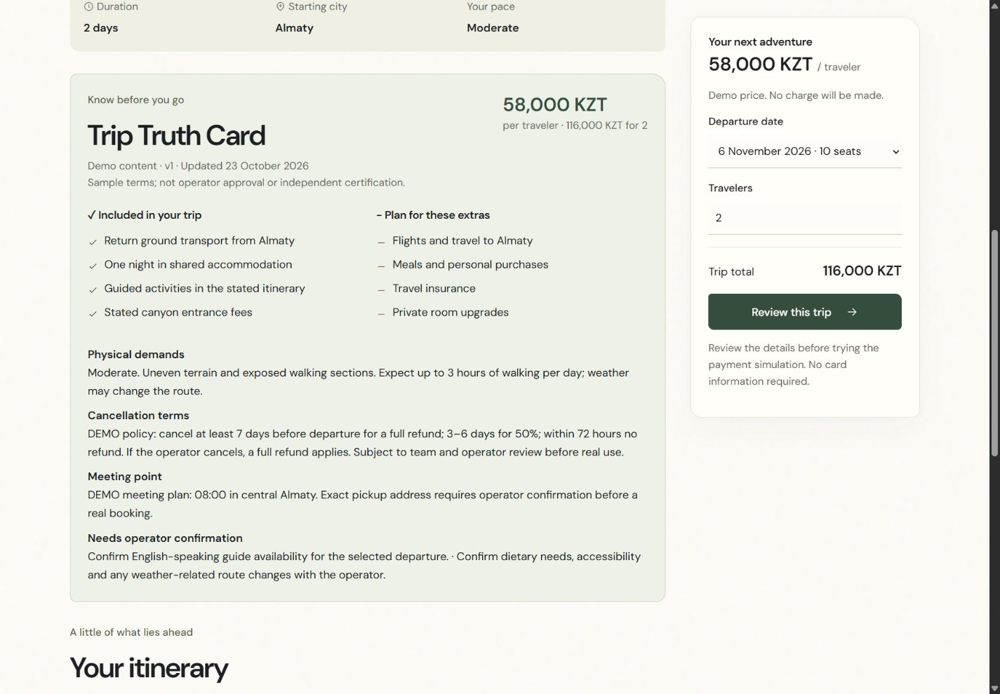
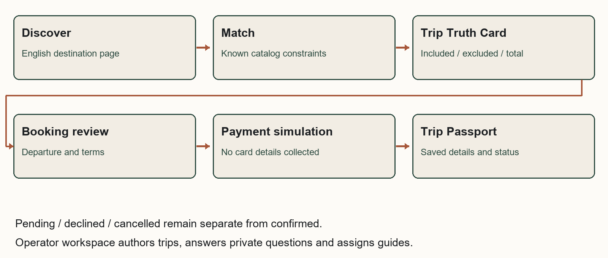

<!-- Report page 1; main report content -->

# Samal Journey

Technology product proposal for Saryarqa Routes

REVIEW DRAFT  |  Team name pending  |  ZERTTEX Hackathon 2026  |  23 October 2026

## Problem and market

Samal Journey is a proposed booking product for Saryarqa Routes. It gives travelers one consistent record of what a trip includes, what it costs and what happens after booking. The proposed first market is a small segment of travelers from India. A limited pilot is worth testing, but demand and operating arrangements remain unconfirmed. The financial forecast reaches payback in month 23 under the base assumptions; 30% fewer new travelers would leave the project below payback after 24 months.

### The company and the booking problem

Saryarqa Routes is the fictional company in the case. Founded in Astana in 2020, it has 9 full-time employees and about 25 freelance guides. It sells guided trips lasting 2-7 days to Charyn Canyon, Kolsai Lakes, Turkestan and Burabay. In 2025, it served 3,400 travelers and earned 150,000,000 KZT, with a stated average price of 44,000 KZT. About 96% of travelers came from Kazakhstan. Sales take place through Instagram messages, WhatsApp and calls; customers pay by Kaspi transfer or cash. Its website is one Russian-language page. The target is a 30% foreign-traveler share within 24 months, with up to 20,000,000 KZT for development and launch in the first year. [C, pp.1-2]

The case describes foreign guests who cannot understand how to book, judge whether the company is trustworthy, pay with a foreign card or identify what is included. These are case statements; this project has not interviewed guests. There is also a small inconsistency in the supplied figures: 3,400 multiplied by 44,000 is 149,600,000 KZT, or 400,000 below the reported revenue. Both original values are retained. [C]

### A proposed market to test

| Country | Accommodation guests | Implication for this proposal |
| --- | --- | --- |
| China | 127,059 | Largest of these three flows; language and sales channels need separate research. |
| India | 91,148 | Proposed first market, with documented visa-free access and air routes. |
| Germany | 24,672 | An alternative with a smaller recorded flow; customer value is unmeasured. |

These are guests from the named countries in Kazakhstan hotels and other accommodation during January-September 2024. The government summary cites the Bureau of National Statistics. It does not establish leisure demand, unique people or customers available to this company; the country definition and repeat-stay treatment are not fully explained. [S01]

The proposed segment is India-resident adults comfortable booking in English, traveling as couples or small friend groups and considering a 2-3 day nature trip from Almaty. This preference still needs research. The Indian Embassy describes visa-free stays for Indian citizens of up to 14 days, within a 42-day limit per 180 days. Air India documents Air Astana flights between Almaty and Delhi/Mumbai; its September 2025 codeshare announcement required regulatory approval. Citizenship, current entry rules, flight schedules and the operator's ability to run Almaty departures must be checked for a pilot. [S02, S03]

For this segment, the Russian-only page may hinder discovery and independent booking. Test English destination pages and a capped search campaign aimed at people already considering Kazakhstan. Measure completed trips and their contribution, alongside visits and inquiries. Clear exclusions, meeting details and cancellation terms address the case complaints; payment recovery should explain whether a booking is pending, declined or confirmed.

---

<!-- Report page 2; main report content -->

## Existing solutions and proposed value

Saryarqa Routes could configure an existing booking service instead of building Samal Journey. Viator and Bókun cover much of the required journey. Their published features are useful comparison points, but local payment compatibility and total cost still need checking. [S04, S04a, S05]

| Dimension | Viator marketplace | Bókun operator software |
| --- | --- | --- |
| Discovery and booking | Marketplace distribution with customer booking and payment. | Direct-booking widgets and connections to online travel agencies and marketplaces. |
| Content and availability | Operators set listing content, retail price and availability; listings undergo review. | Operators manage product content, availability, resources and payment links. |
| Payments and operations | Handles payment/refunds and pays after the experience. Kazakhstan payout eligibility remains unverified. | Manages bookings and distribution channels. Kazakhstan gateway support and a Halyk connection remain unverified. |
| Published cost | USD29 per submitted product plus commission on completed bookings. The exact commission needs a contract. | START: $49/month as displayed, plus 1.5% on applicable bookings and up to five users. Billing currency, setup and payment terms need confirmation. |

Viator specifies USD; the opened Bókun page displays a dollar sign without an explicit billing currency. No currency conversion is assumed. During weeks 1-2, test whether either service meets the operator's workflow and payment requirements at a lower total cost. If it does, configuration is preferable. Custom software adds maintenance and security work, so its benefit must be demonstrated.

### One trip record throughout the booking

The Trip Truth Card stores the itinerary, departure and meeting details, price, inclusions, exclusions, physical demands, cancellation policy and content status. Matching, checkout and the Trip Passport reuse that record. For Saryarqa Routes, the proposed value is fewer conflicting promises across sales and follow-up. This is a practical design choice whose effect needs testing; the report does not claim that structured trip information is a new invention.

---

<!-- Report page 3; main report content -->

## Product journey and technical scope

The product has five parts: catalog matching, the Trip Truth Card, guided booking, the Trip Passport and an operator workspace. Matching checks dates, party size, budget, starting city, interests and difficulty against available departures. Checkout preserves a traveler's draft during navigation or reload and asks for consent again when terms change. The Trip Passport shows the current booking status; only simulated success marks it confirmed. It keeps the accepted price and policy even if the catalog is edited later.

Operators can create tours, revise content and future capacity, assign guides and answer private questions. Travelers see the saved answer in their booking record. The software uses the catalog for prices and availability; an operator must answer questions that the catalog cannot resolve.

### What the demonstration proves

The local application runs on Node 24.16 with HTML, CSS, JavaScript and a JSON data file. It needs no npm dependencies or paid API. It includes no live AI, real payment integration or service worker. Its presentation mode creates future sample dates and backs up its own data before a reset. Responsive pages use local fonts and licensed destination photographs without photo effects. Tour policies, capacity and traveler records are demonstration data, and an entered guide name is not a verified qualification.

Public use would require authenticated operator roles, transactional storage, temporary seat reservations with expiry, an audit trail, backups and a hosted payment page. Demo access and local JSON storage are insufficient for production. The operator must approve privacy terms, retention periods and customer conditions. The demonstration collects neither card numbers nor passport details; no compliance certification is claimed.

### Payment provider requirements

Halyk ePay is a candidate for the pilot. Its documentation describes merchant account/application/terminal onboarding, a published 3% tariff for other-bank cards, English payment pages and KZT request examples. Full and partial refund operations and test/status endpoints are documented. These details do not establish India-issued-card acceptance or settlement currency and timing. Written merchant approval, issuer support, fee/refund terms and end-to-end tests are still needed. The local demo is not a Halyk sandbox. [S06-S10]

Production confirmation must come from a verified final charge. The server should validate the invoice, amount, currency and terminal, check provider notifications and query authenticated payment status. A browser return or successful status query alone does not prove payment. Unique event identifiers and atomic inventory updates must prevent duplicate confirmation or overbooking. [S08-S10]

---

<!-- Report page 4; main report content -->

## MVP plan and validation

The proposed pilot takes about 12 weeks after agreement with the operator. The budget allows 960 paid hours: 180 for product/research, 540 for application/payment engineering, 120 for QA and 120 for content/training. Engineering averages 45 hours per week, shared by a lead and integration support. A product/UX lead, QA/security support and an operator content/launch owner cover the other work. These are planning estimates, not confirmed supplier quotes.

| Weeks | Work and responsibility | Conditions for proceeding |
| --- | --- | --- |
| 1-2 | Product/UX and operator: test the market choice, audit tours, compare configuration with custom development and start payment onboarding. | Team explains its market choice; operator approves a sample Truth Card; merchant requirements are known. |
| 3-4 | Designer and engineer: matching, tour page, responsive layout, catalog schema and inventory model. | Catalog is ready; unsuitable searches and price consistency are tested; early readers understand the terms. |
| 5-6 | Engineer: booking, seat holds, hosted checkout adapter, Passport and operator controls. | Provider test access is approved; duplicate, failed and pending events cannot falsely confirm or overbook. |
| 7-8 | QA/security and operator: test refunds, reconciliation, roles, privacy and content. | Merchant terms are agreed; no critical security/payment defect remains; guides and transport are verified. |
| 9-10 | UX and operator: recruit ten target adults, run consented tasks, train staff and revise. | Use consent and synthetic details; record actual observations and fix serious failures. |
| 11-12 | Engineer and operator: retest, rehearse support and approve a capped pilot. | Support/refund owner, delivery capacity and rollback procedure are ready; required checks pass. |

### Planned participant testing

No interviews or surveys have taken place. Recruit ten India-resident adults who are comfortable booking in English and considering Kazakhstan, with varied devices and travel experience. Explain that participation is voluntary, no purchase is required and recording needs separate consent. Use anonymous codes and synthetic traveler details; collect no card or passport data.

Ask each participant to find a suitable departure, identify two exclusions and the full party charge, explain cancellation, complete a demo booking, recover from a decline and distinguish pending from confirmed. Proposed criteria are 8/10 unassisted core completions, 9/10 correct price/exclusions and 10/10 correct payment-state interpretation. Record actual counts. Ten formative tests can reveal usability failures but cannot establish a conversion increase.

### Completed software checks

Agent-controlled Chrome checks covered 1440, 768 and 360px layouts, filters, tour creation and matching, private answers, guide assignment and payment recovery. A three-person Charyn booking kept its accepted 174,000 KZT total after catalog changes. Drafts survived navigation/reload, while changed terms required fresh consent. Pending, declined and confirmed states remained distinct. All 42 automated tests passed, including regressions for stale responses, multiline input, departure limits and the live party total. These results describe software behavior; no participant outcomes or human approval are claimed.

---

<!-- Report page 5; main report content -->

## Costs and payback

The financial model forecasts incremental cash flows in KZT from January 2027 to December 2028. Development takes months 1-3; running costs and marketing begin in month 4, giving nine active months in year 1 and twelve in year 2. Costs, traffic, conversion and margins are assumptions to test. The model uses the case average of 44,000 KZT per traveler, not the demo tour prices. It counts new completed travelers only; it adds no legacy revenue, migration of existing bookings, internal commission or staff-time saving.

| Initial work | Hours | KZT/hour | KZT |
| --- | --- | --- | --- |
| Research and journey design | 80 | 7,000 | 560,000 |
| Product and interface design | 100 | 8,000 | 800,000 |
| Application engineering | 480 | 9,000 | 4,320,000 |
| QA, accessibility and security review | 120 | 7,000 | 840,000 |
| Approved content and translation | 80 | 6,000 | 480,000 |
| Operator training and launch | 40 | 6,000 | 240,000 |
| Production payment integration allowance | 60 | 9,000 | 540,000 |
| Initial work total | 960 |  | 7,780,000 |

Monthly running cost is 260,000: Hosting and monitoring allowance 35,000; AI usage allowance 15,000; Maintenance 90,000; Customer support 90,000; Content maintenance 30,000. Marketing adds 200,000 per active month. Year-one running and marketing therefore total 2,340,000 and 1,800,000. Contingency is 1,518,000, equal to 15% of combined initial work and year-one running costs; the model treats it as spent in month 3. The model prices the work at stated hourly rates; it does not assume that students or AI make development free.

| 24 month result | Base | 30% fewer new travelers |
| --- | --- | --- |
| Completed new travelers | 1,680 | 1,176 |
| Tour revenue | 73,920,000 | 51,744,000 |
| Contribution after variable costs | 19,219,200 | 13,453,440 |
| Cumulative project cash flow | 261,200 | -5,504,560 |
| Peak month-end funding required | 11,378,800 | 12,147,792 |
| First nonnegative cumulative month | Month 23 / November 2028 | Not reached in 24 months |
| Year 1 gross cash uses | 19,298,800 | 17,540,560 |

At 44,000 revenue per traveler, delivery costs are assumed at 70%, payment at 3% and other variable service at 440. This leaves 11,440 contribution per traveler (26%). The 3% payment input is informed by the published other-bank tariff and still needs merchant confirmation. [S06-S07] Fixed running, marketing, development and contingency are then deducted to calculate undiscounted, incremental pre-tax project cash flow.

The first-year fixed project envelope is 13,438,000. Including incremental tour delivery and variable fees, gross uses are 19,298,800, below the case ceiling of 20,000,000 under a stricter budgeting interpretation. The downside reduces new completed travelers and genuinely variable costs by 30%, while fixed costs and marketing stay unchanged. Payback is not company profit; taxes, settlement delays and supplier terms remain outside the validated assumptions.

---

<!-- Report page 6; main report content -->

## Expected impact and decision

### Demand and capacity are the main constraints

The assumed funnel converts qualified visits into inquiries at 10%, inquiries into paid parties at 15%, and paid bookings into completed trips at 80%, with 2 travelers per party. This yields 180 new travelers in year 1 and 1,500 in year 2. It needs 7,500 then 62,500 qualified sessions, an increase of 8.33 times. The assumed 80% earned/direct/referral/partner traffic is not secured. Marketing cost per new completed traveler falls from 10,000 to 1,600; this improvement is ambitious and untested.

The forecast holds the 2025 legacy base flat at approximately 136 foreign and 3,264 domestic travelers in each year. It assumes 90% of new travelers are foreign. In year 2, foreign share is 1,486 / (1,486 + 3,414) = 30.33%. The downside reaches only 24.29%. Capacity assumes 12 people per group, 4 guide-days including buffer and about 25 freelancers available 12 days/month. Peak base utilization is 84%; language, location, vehicles and actual guide availability remain unverified.

| Risk and responsible role | Response | Warning or stop condition |
| --- | --- | --- |
| Incorrect information / product owner | Approve catalog data; calculate dates, price and seats consistently; route unresolved questions to staff. | An unsupported promise or contradictory price. |
| Payment / finance and engineer | Obtain merchant approval; test issuers, verified events, refunds and reconciliation. | Unknown settlement terms, false confirmation or duplicate charge. |
| Privacy and security / engineer | Limit collected data; secure access, logs and retention; arrange external review. | A sensitive-data leak or critical access flaw. |
| Acquisition / growth owner | Use capped cohorts and measure additional completed trips and contribution. | Acquisition cost exceeds contribution for two cohorts. |
| Delivery / operator | Reserve guides, transport and suppliers before offering capacity. | An unstaffed departure or planned guide load above 85%. |

Company measures should include completed foreign bookings, contribution and support time. Traveler measures should include correct understanding of terms and successful booking completion. Clearer booking information may improve those travelers' experience of Kazakhstan, but one operator's product cannot establish a change in the country's overall tourism image. These effects have not been measured.

### Recommendation

Proceed only with a small pilot after the team has justified its market and product choices and the operator has confirmed delivery and payment arrangements. Base-case cumulative cash first becomes positive in November 2028 and ends at 261,200 KZT. The downside ends at -5,504,560 KZT without payback in 24 months. The narrow base surplus makes working capital and acquisition performance important conditions for expansion.

---

<!-- Report page 7; AI Declaration counted within content limit -->

## AI Declaration

The initial report and much of the supporting analysis were generated by AI. ChatGPT helped develop the supplied concept and brief. Codex generated and revised report text, interpreted sources, built the application and tests, produced the financial model and prepared the Word/PDF files. This was substantive generation and analysis, not grammar-only assistance.

Codex used Superpowers for planning, implementation, debugging and AI code review; browser and web tools for source checks, demo testing and screenshots; and spreadsheet/document/PDF capabilities for calculations and artifacts. Humanizer version 3.1.0 was successfully installed and used to edit the report's prose, captions and this declaration. It is an editing skill, not a human author or evidence that the text was written independently by students. Product Design and Context7 were unavailable and were not used.

The conversation confirms that the user supplied instructions, chose the product identity and visual direction, and requested revisions. It does not establish which team members developed the market strategy, checked sources themselves, validated financial assumptions or approved the conclusions. No interviews, surveys or participant testing are claimed. Substantive team contributions and relevant chat links remain to be supplied.

The organizers' Levels of AI Use framework and the separate Stage 1 Rules & Evaluation Criteria are missing from the identified materials. The applicable level is therefore unclassified; no numbered level is asserted. The case requires the main thinking, ideas and strategy to be the team's own. This review draft does not yet establish that requirement. Team analysis, documented contributions, source review and a final submission decision remain necessary. [C, p.3]

---

<!-- Report page 8; References excluded from content limit -->

## References

External sources were opened and checked on 23 October 2026. Live prices and technical documentation may change. Publication dates are recorded where available; an access date does not establish when an undated page was published. The team still needs to verify these sources itself. [C, p.3]

[C] ZERTTEX Hackathon 2026. Stage 1 Case 1 Technology Product. Released 23 October 2026 at 10:00 Astana time. Three-page supplied case: company facts and requirements pp.1-2; judging criteria and submission checklist p.3. The separate rules and AI-use framework were not supplied.

[S01] Kazakhstan tourism authority citing BNS. ТОП-10 стран: откуда прибыло больше всего туристов в Казахстан?. Publication: Publication not displayed. Data: January-September 2024. https://www.gov.kz/memleket/entities/tourism/press/news/details/939940?lang=ru

[S02] Embassy of India, Astana. Kazakhstan Introduced Visa Free Travel for Citizens of India for up to 14 days. Publication: Original publication unknown; page updated 2026-10-22. Data: Decree 464 of 2022-07-07. https://www.indembastana.gov.in/page/kazakhstan-introduced-visa-free-travel-for-citizens-of-india-for-up-to-14-days/

[S03] Air India. Air India and Air Astana enter codeshare partnership. Publication: 2025-09-10. Data: 2025 announcement. https://www.airindia.com/content/air-india/in/en/newsroom/press-release/Air-India-and-Air-Astana-enter-codeshare-partnership.html

[S04] Jenk Constantine / Viator Operator Resource Center. How Viator Works: Everything You Need to Know Before Listing Your Experience. Publication: 2025-06-03. Data: Operator guidance as accessed. https://operatorresources.viator.com/about-us/

[S04a] Viator. Supplier Center. Publication: Publication not displayed. Data: Live FAQ. https://supplier.viator.com/sign-up-info?m=66029

[S05] Bókun. Pricing. Publication: Publication not displayed. Data: Live plan terms. https://www.bokun.io/pricing

[S06] Halyk Bank. Интернет эквайринг ePay. Publication: Publication not displayed. Data: Live bank terms. https://halykbank.kz/business/payment/epay

[S07] Halyk ePay. Интернет-эквайринг Epay от Halyk Bank. Publication: Publication not displayed. Data: Live provider terms. https://epayment.kz/

[S08] Halyk ePay. Платежная страница. Publication: Publication not displayed. Data: Live unversioned API documentation. https://epayment.kz/docs/platezhnaya-stranica

[S09] Halyk ePay. Возврат/частичный возврат. Publication: Publication not displayed. Data: Live unversioned API documentation. https://epayment.kz/docs/vozvrat-chastichnyi-vozvrat

[S10] Halyk ePay. Статус транзакции. Publication: Publication not displayed. Data: Live unversioned API documentation. https://epayment.kz/docs/check-status-payment

Figure 1 is a genuine local browser capture. Figure 2 is an AI-generated diagram of the proposed workflow, not external evidence. The website's Charyn Canyon photograph is by Bgag, dated 22 September 2023, Wikimedia Commons, CC0 1.0. Full destination-image attributions are in assets/attribution.md.

Image source: https://commons.wikimedia.org/wiki/File:Charyn_Canyon,_Kazakhstan_02.jpg | License: https://creativecommons.org/publicdomain/zero/1.0/deed.en | Checked 23 October 2026.

---
